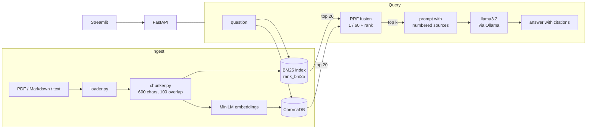

# RAG with hybrid search

Ask questions about your own documents and get answers that cite their
sources. Retrieval combines keyword search (BM25) with meaning-based search
(MiniLM embeddings in ChromaDB), merged with Reciprocal Rank Fusion, and a
local LLM (llama3.2 via Ollama) writes the answer. Everything runs free on
your own machine: no paid API, no API key.

**Results on the included eval** (32 labeled questions, 18 docs, 36 chunks):
hybrid search ranks a correct passage first for **28 of 32** questions,
against 23 for BM25 alone and 24 for vector search alone (MRR 0.918 vs 0.814
and 0.835). [Details below](#evaluation).

<!-- Screenshots: save them in docs/screenshots/ and uncomment.


-->

## Features

- **Hybrid retrieval**: BM25 for exact terms like `ERR-4012`, embeddings for
  paraphrases like "my card was replaced", fused with RRF so neither score
  scale has to be tuned against the other.
- **Cited answers**: the LLM sees numbered sources and must cite `[n]` for
  each claim; out-of-range citations are dropped, and it says so when the
  documents don't cover the question.
- **Transparent ranking**: every result shows its rank in BM25 and in vector
  search, so you can see which retriever found it.
- **Measured, not guessed**: `python cli.py eval` scores all three modes on a
  labeled question set with recall@k and MRR.
- **Three ways in**: command line, FastAPI (`/search`, `/ask`, `/ingest`,
  uploads) and a Streamlit UI.
- **One-command deploy**: `docker compose up` runs the API, UI and Ollama.

## Architecture



## Quickstart (Mac or Linux)

Needs Python 3.11 or newer.

```bash
git clone https://github.com/sonu-oss/rag_project.git
cd rag_project
python3 -m venv .venv
source .venv/bin/activate
pip install -r requirements.txt

python cli.py ingest data/sample --reset
python cli.py search "how do I rotate an API key?"
python cli.py compare "what happens if a card is declined"   # bm25 vs vector vs hybrid
```

To get written answers, install [Ollama](https://ollama.com), open it once so
it runs in the background, and download the model (about 2 GB, one time):

```bash
ollama pull llama3.2
python cli.py ask "how long do refunds take?"
```

### Web app

Run the API and the UI in two terminals (both with `.venv` activated):

```bash
uvicorn api:app --reload      # terminal 1: API on http://localhost:8000 (docs at /docs)
streamlit run ui.py           # terminal 2: UI on http://localhost:8501
```

The UI shows the answer, the numbered sources it cites, and each source's
BM25 and vector rank. You can switch between hybrid, BM25-only and
vector-only, and upload your own PDF, Markdown or text files; they're indexed
as soon as you add them.

## Run with Docker

Install [Docker Desktop](https://www.docker.com/products/docker-desktop/),
start it, then:

```bash
docker compose up --build
```

The first start downloads the llama3.2 model (about 2 GB) and the MiniLM
embedding model; later starts reuse them. Then open:

- UI: http://localhost:8501
- API docs: http://localhost:8000/docs

The sample docs are indexed on start. Stop with `Ctrl+C`; `docker compose down
-v` also deletes the downloaded models and the index.

**Faster answers on a Mac:** Docker on macOS can't use the Apple GPU, so
Ollama inside Docker runs on the CPU. If you have the Ollama app installed,
use it instead:

```bash
OLLAMA_URL=http://host.docker.internal:11434 docker compose up --build api ui
```

## Evaluation

`eval/questions.jsonl` has 32 hand-written questions about the sample docs.
Each one names the file and a phrase from the passage that answers it; a
retrieved chunk counts as correct when it comes from that file and contains
that phrase. The questions come in three kinds:

- **keyword** (12): name an exact identifier, e.g. "What does ERR-4011 mean?"
- **paraphrase** (14): plain words that mostly differ from the docs, e.g.
  "How do I stop someone from faking events sent to my server?" (the doc
  talks about HMAC signatures)
- **factual** (6): share some words with the answer, e.g. "When does a
  checkout session expire?"

| Mode | Recall@1 | Recall@3 | Recall@5 | MRR@10 |
|---|---|---|---|---|
| BM25 | 0.703 | 0.859 | 0.953 | 0.814 |
| Vector (MiniLM) | 0.719 | 0.891 | 0.938 | 0.835 |
| **Hybrid (RRF)** | **0.859** | **0.969** | **1.000** | **0.918** |

| Question type | BM25 MRR | Vector MRR | Hybrid MRR |
|---|---|---|---|
| keyword (12) | **1.000** | 0.753 | 0.944 |
| paraphrase (14) | 0.610 | **0.881** | 0.860 |
| factual (6) | 0.917 | 0.889 | **1.000** |

What this shows: BM25 is best at exact identifiers and vector search is best
at paraphrases, and hybrid stays close to the better of the two on each kind,
so it comes out ahead overall. Per-question ranks are in
[`eval/results.md`](eval/results.md).

Keep in mind that this is a small eval: 32 questions written by the author
over 36 chunks of made-up docs. It is useful for comparing the three modes
against each other, not as a benchmark score.

Re-run it (takes under a minute, builds its own temporary index):

```bash
python cli.py eval
```

This rewrites `eval/results.md` and `eval/results.json`; the header of
`results.md` names the embedder that produced the numbers. If the MiniLM model
can't load, the command stops instead of reporting numbers from the
test-only hashing embedder.

## Models (all free by default)

| Step | Default (free, local) | Optional |
|---|---|---|
| Embeddings | `all-MiniLM-L6-v2` via sentence-transformers, on CPU | OpenAI `text-embedding-3-small` (paid): `RAG_EMBEDDINGS=openai` + `OPENAI_API_KEY` |
| Answers | `llama3.2` via [Ollama](https://ollama.com) | any Ollama model: `OLLAMA_MODEL=...` |

`RAG_EMBEDDINGS` picks the embedder: `minilm` (default), `openai`, or
`hashing` (word overlap only, for tests). The index remembers which embedder
built it; after switching, run `ingest --reset`. See `.env.example` for every
setting.

## API

| Endpoint | What it does |
|---|---|
| `GET /health` | Index stats and which embedder and LLM are in use |
| `POST /ingest` | Index a folder on the server: `{"path": "data/sample", "reset": false}` |
| `POST /ingest/upload` | Upload `.pdf` `.md` `.txt` files (multipart, field `files`) |
| `GET /sources` | Every indexed file and how many chunks it has |
| `POST /search` | `{"query": "...", "k": 5, "mode": "hybrid"}` → ranked chunks |
| `POST /ask` | Same body → `answer`, `citations` (sources it cited), `sources` (all it was shown) |

If Ollama isn't running, `/ask` returns HTTP 503 with a message saying how to
start it.

## How it works

1. **Load and chunk.** Files are read (PDFs page by page) and split with
   LangChain's splitters into 600-character chunks with 100 characters of
   overlap. Each chunk gets a stable id, so re-ingesting adds nothing new.
2. **Retrieve twice.** BM25 (rank_bm25, with a tokenizer that keeps codes like
   `ERR-4012` and `nk_live_` whole) and cosine search over MiniLM embeddings
   in ChromaDB each return their top 20 chunks.
3. **Fuse.** Reciprocal Rank Fusion scores each chunk as the sum of
   `1 / (60 + rank)` over both lists. It uses ranks, not raw scores, so BM25
   scores and cosine similarities never need normalizing, and a chunk both
   retrievers like beats one only a single retriever likes.
4. **Answer.** The top k chunks go into a prompt as numbered sources. The
   model must answer only from them and cite `[n]`; citations are parsed back
   and mapped to their chunks. With an empty index the LLM isn't called.

## Use from Python

```python
from rag import HybridSearcher

hs = HybridSearcher()
hs.ingest("path/to/docs")
for r in hs.search("refund window", k=5, mode="hybrid"):
    print(r.chunk.source, r.score, r.bm25_rank, r.vector_rank)
```

## Project layout

| Path | Role |
|---|---|
| `rag/loader.py` | Read PDF, Markdown and text files |
| `rag/chunker.py` | Split into overlapping chunks with stable ids |
| `rag/embeddings.py` | MiniLM (default), OpenAI (optional), hashing (tests) |
| `rag/vector_store.py` | Persistent ChromaDB collection (cosine) |
| `rag/bm25_index.py` | BM25 keyword index |
| `rag/fusion.py` | Reciprocal Rank Fusion |
| `rag/search.py` | `HybridSearcher`: ingest, search, stats |
| `rag/llm.py` | Ollama client |
| `rag/answer.py` | Prompt with numbered sources, parse `[n]` citations |
| `rag/evaluate.py` | Recall@k and MRR for each search mode |
| `eval/` | Labeled questions and the committed results |
| `api.py` / `ui.py` / `cli.py` | FastAPI backend, Streamlit UI, command line |
| `data/sample/` | Made-up "Nimbus Pay" API docs to try it on |
| `Dockerfile`, `docker-compose.yml` | API + UI + Ollama in containers |

Run the tests with `pytest -q` (they use the offline hashing embedder and a
fake LLM, so they need no downloads).

## License

MIT
